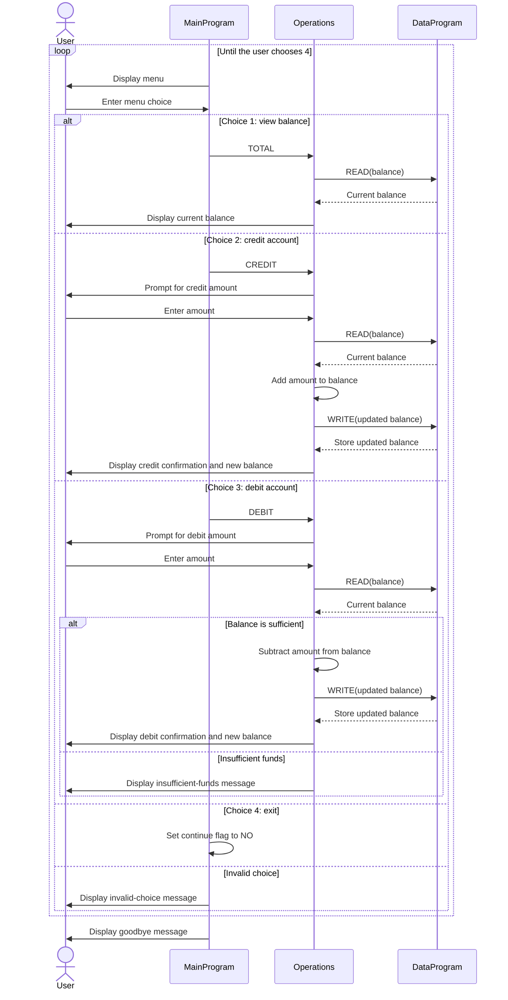

# COBOL student account system

This directory documents the COBOL account-management example in `src/cobol/`.
The program provides a menu to view an account balance, credit the account, or
debit it. Although this example is intended to represent a student account, it
currently manages one shared balance and does not store student names, IDs, or
separate account records.

## COBOL files

| File | Purpose and key functions |
| --- | --- |
| [`main.cob`](../src/cobol/main.cob) | Entry point (`MainProgram`). Displays the menu, accepts a choice, and calls `Operations` with `TOTAL`, `CREDIT`, or `DEBIT`. Choice 4 exits; any other choice displays an invalid-choice message. |
| [`operations.cob`](../src/cobol/operations.cob) | Account operation handler (`Operations`). For a balance inquiry, reads and displays the balance. For a credit, accepts an amount, reads the balance, adds the amount, writes the result, and displays it. For a debit, accepts an amount, checks funds, and either subtracts and writes the result or reports insufficient funds. |
| [`data.cob`](../src/cobol/data.cob) | Balance storage interface (`DataProgram`). A `READ` operation copies the stored balance to the caller; a `WRITE` operation copies the caller's balance into storage. |

## Student-account business rules

- The account starts with a balance of `1000.00`, represented as a COBOL
  numeric field with two implied decimal places.
- A credit adds the entered amount to the balance.
- A debit is allowed only when the current balance is greater than or equal to
  the entered amount. Otherwise, the balance is unchanged and the program
  displays an insufficient-funds message.
- The program does not explicitly validate transaction amounts as positive
  numbers. In the GNU COBOL runtime used to characterize this application,
  entering `-25.00` in the unsigned amount field is treated as `25.00`: a
  credit adds it, and a debit subtracts it.
- The balance is held in working storage, not in a persistent store. It is
  shared by operations during a run, but resets to `1000.00` when the program
  starts again. There is no student identity, account selection, transaction
  history, or per-student balance management in the current implementation.

## Application sequence



## Node.js implementation

The consolidated Node.js application is in `src/accounting/index.js`. It keeps
the same menu and balance behavior, represents amounts as integer cents, and
starts each process with a balance of `1000.00`. Since the COBOL balance field
is limited to `999999.99`, credits that exceed that limit are rejected without
changing the balance. Amounts must be numeric with up to two decimal places;
the sign is treated as positive to match the unsigned COBOL input behavior.

Run it from the project root with:

```bash
cd src/accounting
npm install
npm start
```

The VS Code **Run and Debug** configuration is available in
`.vscode/launch.json`.
